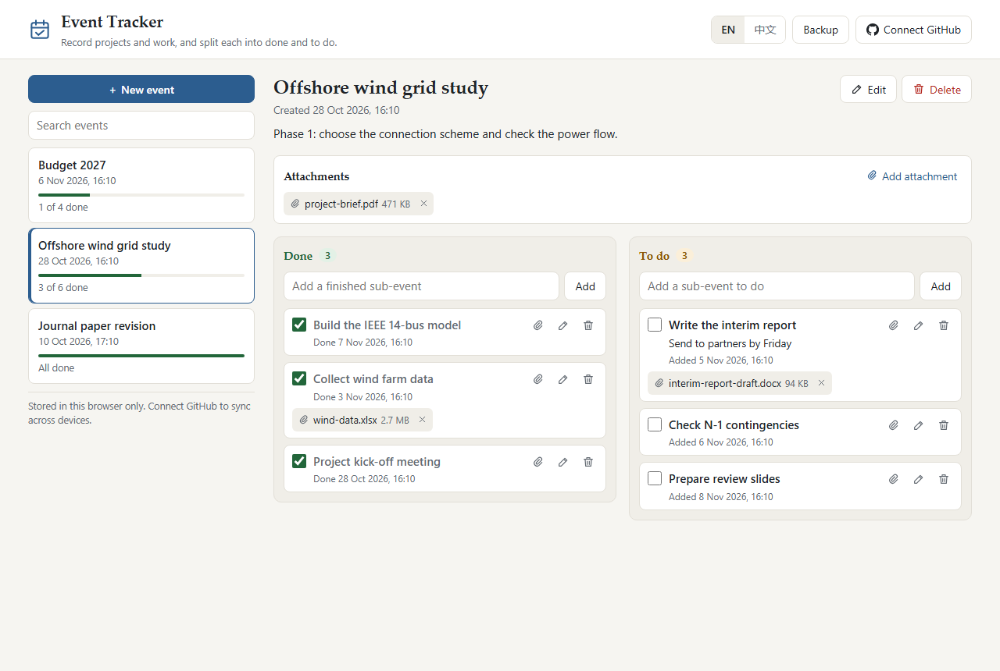

# Event Tracker

**English** | [简体中文](README.zh-CN.md)

> [!NOTE]
> This project was generated with [Claude Code](https://claude.com/claude-code). It has automated tests but has not yet been reviewed by a human. Feedback is welcome: please [open an issue](https://github.com/hanjiang98/AI_toy/issues).

**Try it:** https://hanjiang98.github.io/AI_toy/event-tracker/

A small web page for recording important events, such as projects and pieces of work. Anyone can open the link and start recording. Each person's records are separate from everyone else's. The interface is in English by default, and you can switch it to Chinese.

## Features

- **Events:** the creation time is recorded automatically. Each event has a title and optional notes.
- **Two columns:** every event has a **Done** column and a **To do** column, and you can add sub-events to either.
- **Moving sub-events:** tick the checkbox, or drag a sub-event to the other column. The page records when each one was added and finished.
- **Attachments:** add files to an event or a sub-event, with the button or by dropping them on the page. Each file can be up to 25 MB.
- **Search:** search covers event titles, notes and sub-events.
- **Backup:** export everything, including attachments, to one JSON file, and import it again.
- **GitHub sync (optional):** keep your records in your own GitHub account and use them on several devices.

## Where your records are stored

| | Without GitHub | With GitHub |
|---|---|---|
| Records | This browser (`localStorage`) | A private repository you own, with a copy in this browser |
| Attachments | This browser (IndexedDB) | The same repository, with a copy in this browser |
| Who can see them | Anyone using this browser profile | You, and anyone you give access to the repository |
| If you clear site data | **Everything is lost** unless you have a backup | Everything is still in the repository |

There is no server, no analytics and no third-party script. Nobody else, including the author of this page, can see your records.

## Connect your GitHub account (optional)

1. [Create a private repository](https://github.com/new?name=event-tracker-data&visibility=private), for example `event-tracker-data`.
2. [Create a fine-grained personal access token](https://github.com/settings/personal-access-tokens/new?name=Event%20Tracker&contents=write&expires_in=365):
   - **Repository access:** choose *Only select repositories* and pick the repository from step 1.
   - **Permissions:** set *Contents* to *Read and write*. Nothing else is needed.
3. On the page, click **Connect GitHub**, then enter the repository name and paste the token.
4. On every other device, repeat step 3 with the same repository.

The page writes `events.json` and an `attachments/` folder to that repository. It syncs after every change, when the page opens, and when you return to the tab. If two devices edit the same event or sub-event, the most recent edit wins. Edits to different sub-events are all kept.

### How people stay separate

- Each person connects their own account and their own private repository, so their records never mix.
- Records in the browser are kept per repository. If a second person uses the same browser, they can't see the first person's records after that person disconnects.
- If this browser holds records that aren't in any account when you connect, the page asks before moving them. Choose **Keep them here** if they belong to someone else. They come back after you disconnect.

### Security notes

- The page refuses to sync to a public repository.
- The token is saved in this browser's storage until you click **Disconnect**. Anyone who can use your browser profile can read it, and so can other pages on `hanjiang98.github.io`. Use a token limited to this one repository, give it an expiry date, and [revoke it](https://github.com/settings/personal-access-tokens) if a device is lost. On a shared computer, disconnect when you finish.
- Disconnecting removes the token and the browser's copy. Your repository is not changed.
- A deleted attachment is removed from the repository's current files but stays in its Git history.
- Attachments are always downloaded, never opened inside the page, so a harmful HTML file cannot run here.
- The page's Content Security Policy only allows connections to `api.github.com`.
- "Sign in with GitHub" (OAuth) is not used because it needs a server to hold a client secret, and this project has no server.

## Run locally

Download the `event-tracker` folder and open `index.html` in a browser. It needs no install and no build step.

## Project structure

| File | Purpose |
|---|---|
| `index.html`, `styles.css` | Page and styles |
| `app.js` | Interface, browser storage and sync wiring |
| `i18n.js` | English and Chinese text |
| `store.js` | Data model, merge logic, GitHub client and syncer |
| `tests/mock-github.js` | In-memory stand-in for the GitHub API |
| `tests/store-test.html` | Tests for merging, sync, attachments and account separation |
| `tests/ui-test.html` | Drives the real page in an iframe |

## Tests

Serve this folder over HTTP with any static server, then open the test pages in a browser. Each page lists every case and ends with a summary such as `66/66 passed`.

- `tests/store-test.html`
- `tests/ui-test.html` (this one clears the Event Tracker data for that address, so run it on a local server rather than the live site)

The tests use a mock GitHub API, so they don't touch a real repository.

## License

[MIT](../LICENSE). Provided as is, without warranty. Do not rely on this tool as your only record of important work: keep a backup.
