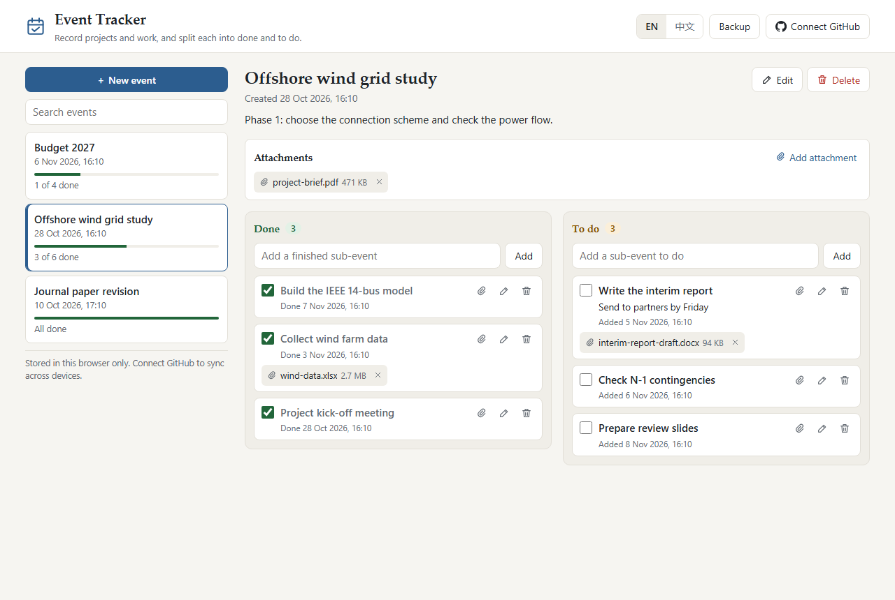

# 事件记录（Event Tracker）

[English](README.md) | **简体中文**

> [!NOTE]
> 本项目由 [Claude Code](https://claude.com/claude-code) 生成，有自动化测试，但尚未经过人工审查。欢迎通过 [Issues](https://github.com/hanjiang98/AI_toy/issues) 反馈。

**在线使用：** https://hanjiang98.github.io/AI_toy/event-tracker/

这是一个用来记录重要事件（如项目和工作）的小网页。任何人打开链接都可以开始记录，每个人的记录互相独立。界面默认为英文，可以切换为中文。

## 功能

- **事件：** 创建时自动记录时间。每个事件有标题和可选的备注。
- **两个栏目：** 每个事件都有**已完成**和**待完成**两栏，两栏都可以添加细分事件。
- **移动细分事件：** 勾选复选框，或把细分事件拖到另一栏。页面会记录每项的添加时间和完成时间。
- **附件：** 可以为事件或细分事件添加文件，点击按钮或把文件拖到页面上即可。单个文件最大 25 MB。
- **搜索：** 搜索范围包括事件标题、备注和细分事件。
- **备份：** 可以把所有内容（包括附件）导出为一个 JSON 文件，之后再导入。
- **GitHub 同步（可选）：** 把记录保存在你自己的 GitHub 账户中，并在多台设备上使用。

## 记录保存在哪里

| | 未绑定 GitHub | 已绑定 GitHub |
|---|---|---|
| 记录 | 此浏览器（`localStorage`） | 你自己的私有仓库，此浏览器中保留一份副本 |
| 附件 | 此浏览器（IndexedDB） | 同一仓库，此浏览器中保留一份副本 |
| 谁能看到 | 使用此浏览器配置文件的任何人 | 你本人，以及你授权访问该仓库的人 |
| 清除网站数据后 | 如果没有备份，**所有内容都会丢失** | 所有内容仍在仓库中 |

本页面没有服务器、没有统计分析，也没有第三方脚本。其他任何人（包括本页面的作者）都看不到你的记录。

## 绑定你的 GitHub 账户（可选）

1. [创建一个私有仓库](https://github.com/new?name=event-tracker-data&visibility=private)，例如 `event-tracker-data`。
2. [创建一个细粒度个人访问令牌](https://github.com/settings/personal-access-tokens/new?name=Event%20Tracker&contents=write&expires_in=365)：
   - **Repository access：** 选择 *Only select repositories*，然后选中第 1 步创建的仓库。
   - **Permissions：** 把 *Contents* 设为 *Read and write*，其他权限都不需要。
3. 在页面上点击 **绑定 GitHub**，填写仓库名称并粘贴令牌。
4. 在其他设备上，用同一个仓库重复第 3 步。

页面会向该仓库写入 `events.json` 和 `attachments/` 文件夹。每次更改后、打开页面时以及回到该标签页时都会同步。如果两台设备修改了同一个事件或细分事件，以最新的修改为准；修改不同的细分事件则都会保留。

### 如何做到互不影响

- 每个人绑定各自的账户和私有仓库，记录不会混在一起。
- 浏览器中的记录按仓库分开保存。如果第二个人使用同一个浏览器，在第一个人解除绑定后，看不到其记录。
- 绑定时，如果此浏览器中有尚未属于任何账户的记录，页面会先询问是否移入。如果它们属于别人，请选择**留在此处**，解除绑定后会重新显示。

### 安全说明

- 页面拒绝同步到公开仓库。
- 令牌保存在此浏览器的存储中，直到你点击**解除绑定**。能使用你浏览器配置文件的人都可以读取它，`hanjiang98.github.io` 下的其他页面也可以。请使用仅限此仓库的令牌并设置有效期；如果设备丢失，请[撤销令牌](https://github.com/settings/personal-access-tokens)。在公用电脑上使用完毕后，请解除绑定。
- 解除绑定会移除令牌和浏览器中的副本，不会改动你的仓库。
- 已删除的附件会从仓库的当前文件中移除，但仍保留在 Git 历史中。
- 附件总是以下载方式打开，不会在页面内打开，因此有害的 HTML 文件无法在此运行。
- 页面的内容安全策略（CSP）只允许连接 `api.github.com`。
- 未使用“使用 GitHub 登录”（OAuth），因为它需要服务器保存客户端密钥，而本项目没有服务器。

## 本地运行

下载 `event-tracker` 文件夹，用浏览器打开 `index.html` 即可，无需安装或构建。

## 项目结构

| 文件 | 用途 |
|---|---|
| `index.html`、`styles.css` | 页面和样式 |
| `app.js` | 界面、浏览器存储和同步逻辑的连接 |
| `i18n.js` | 英文和中文文本 |
| `store.js` | 数据模型、合并逻辑、GitHub 客户端和同步器 |
| `tests/mock-github.js` | 内存中模拟的 GitHub API |
| `tests/store-test.html` | 合并、同步、附件和账户隔离的测试 |
| `tests/ui-test.html` | 在 iframe 中操作真实页面的测试 |

## 测试

用任意静态服务器通过 HTTP 提供此文件夹，然后在浏览器中打开测试页面。每个页面会列出所有用例，并在最后显示类似 `66/66 passed` 的汇总。

- `tests/store-test.html`
- `tests/ui-test.html`（此页面会清除该地址下的事件记录数据，因此请在本地服务器上运行，不要在线上网站运行）

测试使用模拟的 GitHub API，不会访问真实仓库。

## 许可证

[MIT](../LICENSE)。按原样提供，不作任何保证。请不要把本工具作为重要工作的唯一记录，并注意备份。
