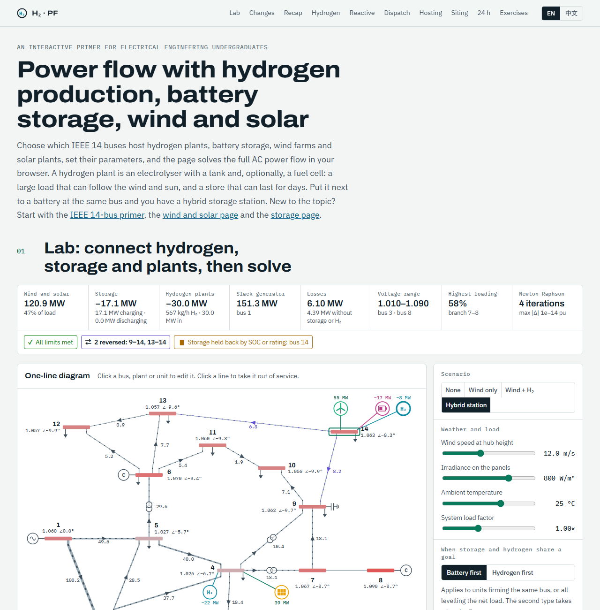

# Hydrogen, Storage, Wind & Solar Power Flow

**[English](#english) · [中文](#中文)**

**Live demo / 在线访问：** https://hanjiang98.github.io/AI_toy/hydrogen-powerflow/

---

## English

An interactive, bilingual (English / 中文) web page that introduces **power flow analysis with large hydrogen production plants, battery storage, wind farms and solar plants** to electrical engineering undergraduates. It uses the IEEE 14-bus test system. English is the default language. It builds on three companion pages: [IEEE 14-Bus Power Flow](../powerflow-ieee14/) for the basics, [Wind & Solar Power Flow](../renewable-powerflow/) for the renewable plant models, and [Storage, Wind & Solar Power Flow](../storage-powerflow/) for battery storage.

> **About this project.** The code was generated with [Claude Code](https://claude.com/claude-code). It is intended **for teaching only**. It is not a validated engineering tool and should not be used for real system planning or operation. Feedback is very welcome: please [open an issue](https://github.com/hanjiang98/AI_toy/issues).

### What you can do

- **Choose where to connect.** Tick any buses to add hydrogen plants, battery storage units, wind farms and solar plants. A bus can host one of each. A battery and a hydrogen plant at the same bus form a hybrid storage station.
- **Set the hydrogen plant's parameters.**
  - Electrolyser: rating, minimum load, hot-standby load and specific energy consumption (kWh/kg).
  - Tank: capacity, present level and a continuous hydrogen offtake (kg/h).
  - Optional fuel cell: rating and efficiency.
  - Rectifier: active front end (IGBT, with reactive control) or thyristor (fixed lagging power factor).
- **Set battery, wind and solar parameters** as on the companion pages, and change wind speed, irradiance, temperature, load and line outages.
- **Choose the dispatch rule** for each battery or hydrogen plant: Setpoint, Firm local output or Level net load. When a battery and a hydrogen plant share a goal, choose which acts first.
- **Read the results.** The AC power flow re-solves on every change. The page shows bus voltages, branch loading, reversed flows, losses, limit violations, hydrogen output and tank level, and what the storage and hydrogen plants change compared with the same case without them.

### What is on the page

| Section | Content |
|---|---|
| 01 Lab | Connection matrix, editor for every unit type, coordination priority, one-line diagram, charts and result tables |
| 02 What changes | How hydrogen plants enter the power flow equations, and how they differ from batteries |
| 03 Recap | Wind, solar and battery models in brief, with the selected units' operating points |
| 04 Hydrogen | Electrolyser, minimum load, tank balance, fuel cell, round-trip efficiency, the one-hour limits and the dispatch rules |
| 05 Reactive power | Converter capability, and the thyristor rectifier as a lagging PQ load |
| 06 Dispatch | Sweeps the selected hydrogen plant or battery across its range, including the minimum-load gap |
| 07 Hosting capacity | Scales wind and solar from 0 to 300%, with and without storage and hydrogen |
| 08 Siting | Adds a drawing (electrolyser) or injecting (fuel cell) unit to each bus in turn and compares losses and limits |
| 09 24 hours | A quasi-static time series that carries each tank level and SOC from hour to hour, with four strategies |
| 10 Exercises | Ten questions with answers. The numbers are computed by the solver at page load |

### Verification

Automated checks run during development, in headless Chrome:

- With no plants, the base case reproduces the published MATPOWER `case14` results: slack 232.39 MW and −16.55 MVAr, losses 13.393 MW, in 4 Newton–Raphson iterations.
- An electrolyser with an active front end at unity power factor gives the same voltages as an equal extra load (largest difference 2 × 10⁻¹⁴). A thyristor-rectifier electrolyser gives exactly the same voltages as a PQ load with Q = P tan φ.
- The minimum load, hot standby, tank and fuel-cell limits were checked against hand calculations. For example, a 10 t tank at 99% with a 300 kg/h offtake has room for 400 kg in the next hour, so a 53 kWh/kg electrolyser can draw at most 21.2 MW.
- 800 random cases (786 solved, 14 without a solution) with 1,103 hydrogen plants showed no violation of the minimum-load gap, the tank and fuel-cell limits, the thyristor Q law or system power balance (to within the solver tolerance). In 90 random 24-hour runs (30 cases × 3 strategies), every tank level and SOC stayed in range, and each tank's hydrogen balance closed exactly.
- The page was checked for script errors, undefined values and horizontal overflow in both languages at 1280 and 500 px, in light and dark themes.

**This page has been reviewed and tested by a human.** The hydrogen cases have no external reference solution: they were cross-checked against equivalent loads in the same solver, not against separate power flow software. The 14 random cases without a solution were not examined one by one.

### Modelling assumptions

- Each plant, battery and hydrogen plant is one equivalent unit connected directly to its bus, with no collector network or step-up transformer.
- Electrolyser and fuel-cell efficiencies are constant. Compression energy is folded into the specific consumption. There is no start-up time, ramp limit, stack degradation or cold start.
- Below its minimum load the electrolyser stops and draws a small hot-standby load.
- The hydrogen offtake is constant and has priority over the fuel cell.
- A snapshot checks that the requested power can be held for one hour within the tank or SOC limits.
- The thyristor rectifier has a constant power factor, with no harmonics or filters.
- The dispatch rules are simple rules computed before the network solve. They are not an optimal power flow, and they ignore network losses and hydrogen prices.
- Only steady-state, balanced operation is covered. The slack generator at bus 1 takes up every change.
- **Teaching values, not part of the IEEE test case:** all hydrogen, storage and plant parameters, branch ratings (140% of base-case flow, rounded up to 5 MVA, minimum 20 MVA), the default voltage limits (0.94–1.10 pu) and the daily profiles.

### Run it locally

There is no build step. Everything is in the single file `index.html`. Open it in a modern browser. An internet connection is needed for the web fonts and for [MathJax 3.2.2](https://www.mathjax.org/) (loaded from jsDelivr). Offline, the solver and charts still work, but the equations appear as LaTeX source.

### Data and references

IEEE 14-bus test case from the [University of Washington Power Systems Test Case Archive](https://labs.ece.uw.edu/pstca/), with the same values as MATPOWER's `case14`.

- A. Buttler, H. Spliethoff, “Current status of water electrolysis for energy storage, grid balancing and sector coupling via power-to-gas and power-to-liquids: A review,” *Renewable and Sustainable Energy Reviews*, vol. 82, pp. 2440–2454, 2018.
- O. Schmidt et al., “Future cost and performance of water electrolysis: An expert elicitation study,” *International Journal of Hydrogen Energy*, vol. 42, no. 52, pp. 30470–30492, 2017.
- IRENA, *Green Hydrogen Cost Reduction: Scaling up Electrolysers to Meet the 1.5 °C Climate Goal*, International Renewable Energy Agency, 2020.
- A. A. Akhil et al., *DOE/EPRI Electricity Storage Handbook in Collaboration with NRECA*, Sandia National Laboratories, SAND2015-1002, 2015.
- IEEE Std 2800-2022, interconnection and interoperability of inverter-based resources with transmission systems.
- J. J. Grainger, W. D. Stevenson, *Power System Analysis*, McGraw-Hill, 1994.

### Feedback

Found an error in the physics, a bug, or a translation that reads badly? Please [open an issue](https://github.com/hanjiang98/AI_toy/issues). Pull requests are welcome too.

### License

[MIT](../LICENSE)

---

## 中文

一个面向电气工程专业本科生的交互式双语（English / 中文）网页，以 IEEE 14 节点测试系统为例，介绍**接入大规模制氢储能电站、电池储能、风电场和光伏电站的电网潮流计算**。默认显示英文，可在页面右上角切换中文。本页建立在三个姊妹页面之上：基础知识见 [IEEE 14 节点潮流计算](../powerflow-ieee14/)，新能源电站模型见[风电光伏接入潮流计算](../renewable-powerflow/)，电池储能见[储能与风光接入潮流计算](../storage-powerflow/)。

> **关于本项目。** 本项目代码由 [Claude Code](https://claude.com/claude-code) 生成，**仅用于教学**。它不是经过工程验证的计算工具，请勿用于实际电网的规划或运行。欢迎反馈：请[提交 Issue](https://github.com/hanjiang98/AI_toy/issues)。

### 可以做什么

- **选择接入节点。** 勾选任意节点即可增加制氢站、电池储能、风电场或光伏电站，每个节点每类最多一个。电池储能和制氢站接在同一节点，就构成混合储能电站。
- **设置制氢站参数。**
  - 电解槽：额定功率、最小负荷、热备用功率和单位电耗（kWh/kg）。
  - 储氢罐：容量、当前液位和持续的氢气外送量（kg/h）。
  - 可选的燃料电池：额定功率和效率。
  - 整流器：有源前端（IGBT，可控制无功）或晶闸管（固定的滞后功率因数）。
- **设置电池储能、风电和光伏参数**（与姊妹页面相同），并可改变风速、辐照度、温度、负荷和线路投切。
- **选择每个电池储能或制氢站的控制策略**：给定功率、平抑本节点出力或削峰填谷。电池和制氢站目标相同时，可选择谁先动作。
- **查看结果。** 每次修改都会重新求解交流潮流，页面显示节点电压、支路负载率、反向潮流、网损、越限情况、产氢量和储氢罐液位，以及与去掉储能和制氢站的同一算例相比，它们带来了哪些变化。

### 页面内容

| 章节 | 内容 |
|---|---|
| 01 实验台 | 接入节点矩阵、各类设备参数编辑、协调优先级、单线图、图表和结果表 |
| 02 变化 | 制氢站如何进入潮流方程，与电池储能有何不同 |
| 03 回顾 | 风电、光伏和电池储能模型回顾，显示所选设备的运行点 |
| 04 制氢 | 电解槽、最小负荷、储氢罐平衡、燃料电池、往返效率、一小时限值和控制策略 |
| 05 无功功率 | 变流器运行范围，以及晶闸管整流器作为滞后 PQ 负荷 |
| 06 功率扫描 | 在整个范围内扫描所选制氢站或电池储能的功率，包括最小负荷以下的空缺 |
| 07 承载能力 | 把风电和光伏从 0 放大到 300%，对比有无储能和制氢 |
| 08 选址 | 把一个取电（电解槽）或送电（燃料电池）的设备依次接到各节点，比较网损和限值 |
| 09 24 小时 | 准静态时序仿真，逐小时传递每个储氢罐液位和 SOC，提供四种策略 |
| 10 练习 | 10 道题及答案，答案中的数字都在页面加载时由求解器算出 |

### 验证

开发过程中在无头 Chrome 中运行的自动检查：

- 不接电站时，基础算例与 MATPOWER `case14` 的公开结果一致：平衡机 232.39 MW、−16.55 MVAr，网损 13.393 MW，牛顿法 4 次迭代。
- 单位功率因数的有源前端电解槽与等量增加的负荷电压结果相同（最大差值 2 × 10⁻¹⁴）；晶闸管整流的电解槽与 Q = P tan φ 的 PQ 负荷结果完全相同。
- 最小负荷、热备用、储氢罐和燃料电池限值已与手算结果核对。例如 10 t 储氢罐液位 99%、外送 300 kg/h 时，下一小时还能容纳 400 kg，单位电耗 53 kWh/kg 的电解槽最多只能吸收 21.2 MW。
- 800 个随机算例（786 个有解、14 个无解）共含 1,103 个制氢站，最小负荷空缺、储氢罐和燃料电池限值、晶闸管无功关系以及系统功率平衡（在求解器容差范围内）均未出现违反。90 次随机 24 小时仿真（30 个算例 × 3 种策略）中，储氢罐液位和 SOC 都在允许范围内，每个储氢罐的氢气平衡都严格闭合。
- 页面在 1280 px 和 500 px 宽度、中英文、浅色和深色主题下检查过，没有脚本错误、未定义数值和横向溢出。

**本页面已经过人工审查和测试。**制氢算例没有外部参考解：它们是与同一求解器中的等效负荷对比，而不是与其他潮流软件对比。14 个无解的随机算例没有逐个检查。

### 模型假设

- 每座电站、每个电池储能和每个制氢站都等值为一台直接接在节点上的设备，没有集电网络和升压变压器。
- 电解槽和燃料电池效率为常数，储氢压缩能耗计入单位电耗，不考虑启动时间、爬坡限制、电堆衰减和冷启动。
- 低于最小负荷时电解槽停止制氢，只消耗少量热备用功率。
- 氢气外送量恒定，优先于燃料电池用氢。
- 单张快照检查要求的功率能否在储氢罐或 SOC 限值内维持一小时。
- 晶闸管整流器的功率因数为常数，不考虑谐波和滤波器。
- 控制策略是在求解网络之前算出的简单规则，不是最优潮流，不计网损，也不考虑氢气价格。
- 只考虑三相平衡稳态运行。任何变化都由节点 1 的平衡机承担。
- **以下是教学取值，不属于 IEEE 测试系统：** 全部制氢、储能和电站参数、支路容量（基础算例潮流的 140%，向上取整到 5 MVA，最小 20 MVA）、默认电压限值（0.94–1.10 pu）和典型日曲线。

### 本地运行

无需编译，全部代码都在 `index.html` 一个文件里，用现代浏览器打开即可。网页字体和 [MathJax 3.2.2](https://www.mathjax.org/)（从 jsDelivr 加载）需要联网。离线时求解器和图表仍可使用，但公式会显示为 LaTeX 源码。

### 数据与参考文献

IEEE 14 节点测试系统取自[华盛顿大学电力系统测试算例库](https://labs.ece.uw.edu/pstca/)，参数与 MATPOWER 的 `case14` 相同。参考文献见上方英文部分。

### 反馈

如果发现原理错误、程序 bug 或翻译不通顺的地方，请[提交 Issue](https://github.com/hanjiang98/AI_toy/issues)，也欢迎提交 Pull Request。

### 许可证

[MIT](../LICENSE)
