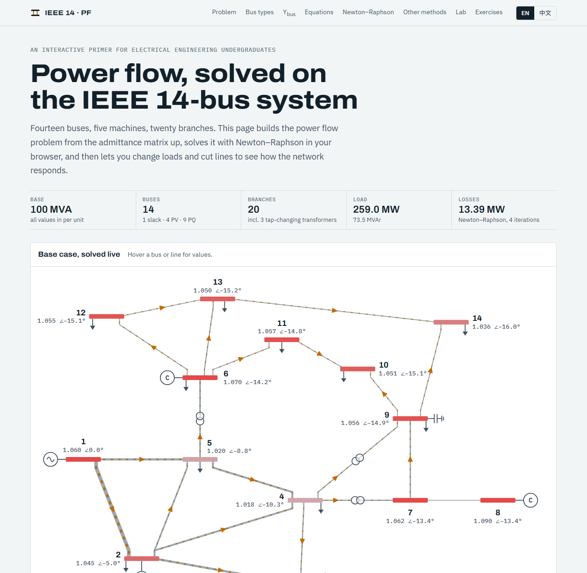

# IEEE 14-Bus Power Flow

**[English](#english) · [中文](#中文)**

**Live demo / 在线访问：** https://hanjiang98.github.io/AI_toy/powerflow-ieee14/

---

## English

An interactive, bilingual (English / 中文) web page that introduces **power flow (load flow) analysis** to electrical engineering undergraduates, using the IEEE 14-bus test system. English is the default language.

> **About this project.** The code was generated with [Claude Code](https://claude.com/claude-code) and has been reviewed and tested by a human. It is intended **for teaching only**. It is not a validated engineering tool and should not be used for real system planning or operation. Feedback is very welcome: please [open an issue](https://github.com/hanjiang98/AI_toy/issues).

### What is on the page

| Section | Content |
|---|---|
| 01 The problem | What power flow solves: inputs, outputs, standard assumptions |
| 02 Bus types | Slack, PV and PQ buses, and why IEEE 14 has 22 unknowns |
| 03 Ybus | π line model, off-nominal tap transformer, interactive admittance matrix heatmap (\|Y\|, G, B) |
| 04 Equations | Polar power flow equations and power mismatches |
| 05 Newton–Raphson | Jacobian blocks H, N, M, L and the algorithm. An iteration explorer shows every mismatch, the 22 × 22 Jacobian and the bus voltages at each iteration |
| 06 Other methods | Gauss–Seidel and fast decoupled (XB) load flow, with a convergence comparison chart |
| 07 Lab | Change the load factor, edit loads and generator setpoints, switch lines out of service, enforce generator Q limits (PV → PQ switching), and compare the three solvers. Bus and branch result tables update live |
| 08 Exercises | Eight questions with answers. Every number in the answers is computed by the solver at page load |

### Verification

The solver is written from scratch in JavaScript. For the base case, Newton–Raphson converges in 4 iterations (tolerance 10⁻⁸ pu) and reproduces the published MATPOWER `case14` results:

| Quantity | This page | MATPOWER `case14` |
|---|---|---|
| Slack generator (bus 1) | 232.39 MW, −16.55 MVAr | 232.39 MW, −16.55 MVAr |
| Bus 2 generator Q | 43.56 MVAr | 43.56 MVAr |
| Condensers at buses 3, 6, 8 (Q) | 25.08, 12.73, 17.62 MVAr | 25.08, 12.73, 17.62 MVAr |
| Bus 14 voltage | 1.036 pu ∠ −16.03° | 1.036 pu ∠ −16.03° |
| Total losses | 13.393 MW | 13.393 MW |

Fast decoupled and Gauss–Seidel converge to the same solution, in 8 and 102 iterations respectively. Those two counts depend on implementation details, such as the XB scheme and the acceleration factor α = 1.6 used for Gauss–Seidel.

### Run it locally

There is no build step. Everything is in the single file `index.html`.

1. Download or clone this repository.
2. Open `powerflow-ieee14/index.html` in a modern browser.

An internet connection is needed for the web fonts and for [MathJax 3.2.2](https://www.mathjax.org/) (loaded from jsDelivr), which renders the equations. Offline, the solver and diagrams still work, but the equations appear as LaTeX source.

### Data

IEEE 14-bus test case: a portion of the American Electric Power system as of February 1962, from the [University of Washington Power Systems Test Case Archive](https://labs.ece.uw.edu/pstca/). The values are the same as MATPOWER's `case14`, on a 100 MVA base.

### References

- J. J. Grainger, W. D. Stevenson, *Power System Analysis*, McGraw-Hill, 1994.
- J. D. Glover, T. J. Overbye, M. S. Sarma, *Power System Analysis and Design*, 6th ed., Cengage, 2017.
- B. Stott, O. Alsac, "Fast decoupled load flow," *IEEE Trans. PAS*, vol. 93, no. 3, pp. 859–869, 1974.
- R. D. Zimmerman, C. E. Murillo-Sánchez, R. J. Thomas, "MATPOWER," *IEEE Trans. Power Systems*, vol. 26, no. 1, pp. 12–19, 2011.

### Feedback

Found an error in the physics, a bug, or a translation that reads badly? Please [open an issue](https://github.com/hanjiang98/AI_toy/issues). Pull requests are welcome too.

### License

[MIT](../LICENSE)

---

## 中文

一个面向电气工程专业本科生的交互式双语（English / 中文）网页，以 IEEE 14 节点测试系统为例介绍**电力系统潮流计算**。默认显示英文，可在页面右上角切换中文。

> **关于本项目。** 本项目代码由 [Claude Code](https://claude.com/claude-code) 生成，已经过人工审查和测试，**仅用于教学**。它不是经过工程验证的计算工具，请勿用于实际电网的规划或运行。欢迎反馈：请[提交 Issue](https://github.com/hanjiang98/AI_toy/issues)。

### 页面内容

| 章节 | 内容 |
|---|---|
| 01 问题 | 潮流计算要解决什么：已知输入、计算输出、标准假设 |
| 02 节点类型 | 平衡节点、PV 节点、PQ 节点，以及 IEEE 14 节点系统为什么有 22 个未知量 |
| 03 导纳矩阵 | π 型线路模型、非标准变比变压器模型、可交互的节点导纳矩阵热力图（\|Y\|、G、B） |
| 04 潮流方程 | 极坐标形式的潮流方程和功率不平衡量 |
| 05 牛顿–拉夫逊法 | 雅可比矩阵的 H、N、M、L 四个分块及算法步骤；迭代过程面板逐次显示各方程的不平衡量、22 × 22 雅可比矩阵和节点电压 |
| 06 其他方法 | 高斯–赛德尔法和 P-Q 分解法（XB 型），附收敛过程对比图 |
| 07 实验台 | 调整负荷系数、修改负荷和发电机设定值、断开线路、考虑发电机无功限值（PV → PQ 转换），并比较三种算法；节点和支路结果表实时更新 |
| 08 练习 | 8 道题及答案，答案中的数字都在页面加载时由求解器实时算出 |

### 验证

求解器用 JavaScript 从零编写。基础算例下，牛顿–拉夫逊法 4 次迭代收敛（精度 10⁻⁸ pu），结果与 MATPOWER `case14` 的公开结果一致：

| 物理量 | 本页结果 | MATPOWER `case14` |
|---|---|---|
| 平衡机（节点 1） | 232.39 MW，−16.55 MVAr | 232.39 MW，−16.55 MVAr |
| 节点 2 发电机无功 | 43.56 MVAr | 43.56 MVAr |
| 节点 3、6、8 调相机无功 | 25.08、12.73、17.62 MVAr | 25.08、12.73、17.62 MVAr |
| 节点 14 电压 | 1.036 pu ∠ −16.03° | 1.036 pu ∠ −16.03° |
| 全网网损 | 13.393 MW | 13.393 MW |

P-Q 分解法和高斯–赛德尔法收敛到相同的解，分别需要 8 次和 102 次迭代。这两个迭代次数取决于具体实现，例如采用 XB 型方案、高斯–赛德尔法的加速因子取 α = 1.6。

### 本地运行

无需编译或安装，全部代码都在 `index.html` 一个文件里。

1. 下载或克隆本仓库。
2. 用现代浏览器打开 `powerflow-ieee14/index.html`。

网页字体和公式渲染库 [MathJax 3.2.2](https://www.mathjax.org/)（从 jsDelivr 加载）需要联网。离线时求解器和图表仍可正常使用，但公式会显示为 LaTeX 源码。

### 数据来源

IEEE 14 节点测试系统：美国电力公司（AEP）1962 年 2 月电网的一部分，取自[华盛顿大学电力系统测试算例库](https://labs.ece.uw.edu/pstca/)，参数与 MATPOWER 的 `case14` 相同，基准容量 100 MVA。

### 参考文献

见上方英文部分的 References。

### 反馈

如果发现原理错误、程序 bug 或翻译不通顺的地方，请[提交 Issue](https://github.com/hanjiang98/AI_toy/issues)，也欢迎提交 Pull Request。

### 许可证

[MIT](../LICENSE)
