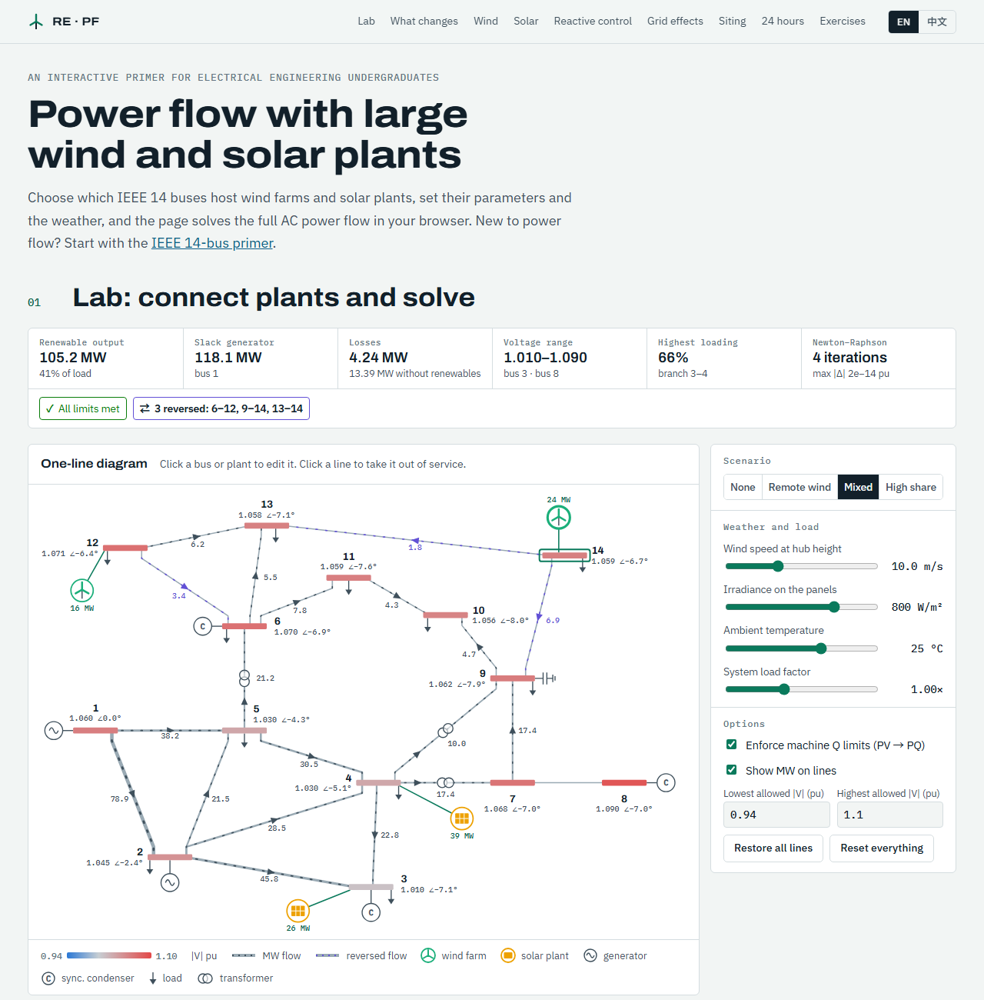

# Wind & Solar Power Flow

**[English](#english) · [中文](#中文)**

**Live demo / 在线访问：** https://hanjiang98.github.io/AI_toy/renewable-powerflow/

---

## English

An interactive, bilingual (English / 中文) web page that introduces **power flow analysis with large wind farms and solar plants** to electrical engineering undergraduates. It uses the IEEE 14-bus test system. English is the default language. For the basics of power flow, see the companion page, [IEEE 14-Bus Power Flow](../powerflow-ieee14/).

> **About this project.** The code was generated with [Claude Code](https://claude.com/claude-code) and has been reviewed and tested by a human. It is intended **for teaching only**. It is not a validated engineering tool and should not be used for real system planning or operation. Feedback is very welcome: please [open an issue](https://github.com/hanjiang98/AI_toy/issues).

### What you can do

- **Choose where to connect.** Tick any buses to add wind farms and solar plants. A bus can host one of each.
- **Set plant parameters.**
  - Wind: number of turbines, turbine rating, cut-in, rated and cut-out speeds, wake and availability losses, converter rating, site wind factor.
  - Solar: DC capacity, DC/AC ratio, temperature coefficient, NOCT, system efficiency, site irradiance factor.
  - Both: active power limit (curtailment) and reactive control mode: constant power factor, voltage control or Q(V) droop.
- **Change the conditions.** Set wind speed, irradiance, temperature and load factor, take lines out of service, and edit loads and machine setpoints.
- **Read the results.** The AC power flow re-solves on every change, and the page shows bus voltages, branch loading, reversed flows, losses, and voltage and thermal limit violations.

### What is on the page

| Section | Content |
|---|---|
| 01 Lab | Connection matrix, plant editor, one-line diagram, charts and result tables |
| 02 What changes | How plants enter the power flow equations |
| 03 Wind | Power curve model, with the selected farm's operating point |
| 04 Solar | Irradiance, cell temperature and inverter clipping |
| 05 Reactive control | Converter capability, and how each control mode maps to a bus type, including the Jacobian term for Q(V) |
| 06 Grid effects | Voltage rise, reverse flow, the U-shaped loss curve and a capacity sweep |
| 07 Siting | Adds one more plant to each bus in turn and compares losses and limits |
| 08 24 hours | A quasi-static time series over three illustrative days |
| 09 Exercises | Nine questions with answers. The numbers are computed by the solver at page load |

### Verification

Automated checks run during development, in headless Chrome:

- With no plants, the base case reproduces the published MATPOWER `case14` results: slack 232.39 MW and −16.55 MVAr, losses 13.393 MW, in 4 Newton–Raphson iterations.
- A constant power factor plant gives the same voltages as an equivalent negative load, and a voltage-controlled plant gives the same voltages as an equivalent PV generator.
- Q(V) droop satisfies its control law at the solution and keeps Newton's fast convergence.
- 600 random cases (525 solved, 63 without a solution, 12 islanded) showed no violation of bus power balance, system power balance, the converter S limit, or Q-limit switching logic.

The plant cases have no external reference solution: they were cross-checked against models built from the same solver core, not against separate power flow software.

### Modelling assumptions

- Each plant is one equivalent machine connected directly to its bus, with no collector network or step-up transformer.
- All plants share one weather input, apart from a site factor.
- Only steady-state, balanced operation is covered. There is no frequency response, stability, fault ride-through, harmonics or forecast uncertainty.
- The slack generator at bus 1 takes up every change in renewable output.
- **Teaching values, not part of the IEEE test case:** plant parameters, branch ratings (140% of base-case flow, rounded up to 5 MVA, minimum 20 MVA), the default voltage limits (0.94–1.10 pu) and the daily profiles.

### Run it locally

There is no build step. Everything is in the single file `index.html`. Open it in a modern browser. An internet connection is needed for the web fonts and for [MathJax 3.2.2](https://www.mathjax.org/) (loaded from jsDelivr). Offline, the solver and charts still work, but the equations appear as LaTeX source.

### Data and references

IEEE 14-bus test case from the [University of Washington Power Systems Test Case Archive](https://labs.ece.uw.edu/pstca/), with the same values as MATPOWER's `case14`.

- T. Ackermann (ed.), *Wind Power in Power Systems*, 2nd ed., Wiley, 2012.
- G. M. Masters, *Renewable and Efficient Electric Power Systems*, 2nd ed., Wiley, 2013.
- IEEE Std 2800-2022, interconnection and interoperability of inverter-based resources with transmission systems.
- IEEE Std 1547-2018, interconnection of distributed energy resources with electric power systems.
- J. J. Grainger, W. D. Stevenson, *Power System Analysis*, McGraw-Hill, 1994.

### Feedback

Found an error in the physics, a bug, or a translation that reads badly? Please [open an issue](https://github.com/hanjiang98/AI_toy/issues). Pull requests are welcome too.

### License

[MIT](../LICENSE)

---

## 中文

一个面向电气工程专业本科生的交互式双语（English / 中文）网页，以 IEEE 14 节点测试系统为例，介绍**接入大规模风电场和光伏电站的电网潮流计算**。默认显示英文，可在页面右上角切换中文。潮流计算的基础知识见姊妹页面 [IEEE 14 节点潮流计算](../powerflow-ieee14/)。

> **关于本项目。** 本项目代码由 [Claude Code](https://claude.com/claude-code) 生成，已经过人工审查和测试，**仅用于教学**。它不是经过工程验证的计算工具，请勿用于实际电网的规划或运行。欢迎反馈：请[提交 Issue](https://github.com/hanjiang98/AI_toy/issues)。

### 可以做什么

- **选择接入节点。** 勾选任意节点即可增加风电场或光伏电站，每个节点最多各接一座。
- **设置电站参数。**
  - 风电：风机台数、单机容量、切入/额定/切出风速、尾流和停机损失、变流器容量、场址风速系数。
  - 光伏：直流装机、容配比、功率温度系数、NOCT、系统效率、场址辐照系数。
  - 通用：有功上限（弃风弃光）和无功控制方式：恒功率因数、恒电压或 Q(V) 下垂。
- **改变运行条件。** 设置风速、辐照度、温度和负荷系数，断开线路，修改负荷和电机设定值。
- **查看结果。** 每次修改都会重新求解交流潮流，页面显示节点电压、支路负载率、反向潮流、网损，以及电压和热稳定越限情况。

### 页面内容

| 章节 | 内容 |
|---|---|
| 01 实验台 | 接入节点矩阵、电站参数编辑、单线图、图表和结果表 |
| 02 有何变化 | 电站如何进入潮流方程 |
| 03 风电 | 功率曲线模型，显示所选风电场的运行点 |
| 04 光伏 | 辐照度、电池温度和逆变器限幅 |
| 05 无功控制 | 变流器运行范围、各控制方式对应的节点类型，以及 Q(V) 在雅可比矩阵中增加的项 |
| 06 电网影响 | 电压升高、潮流反向、U 形网损曲线和容量扫描 |
| 07 接入位置 | 把新增电站依次接到各节点，比较网损和限值 |
| 08 24 小时 | 三个示意典型日的准静态时序仿真 |
| 09 练习 | 9 道题及答案，答案中的数字都在页面加载时由求解器算出 |

### 验证

开发过程中在无头 Chrome 中运行的自动检查：

- 不接电站时，基础算例与 MATPOWER `case14` 的公开结果一致：平衡机 232.39 MW、−16.55 MVAr，网损 13.393 MW，牛顿法 4 次迭代。
- 恒功率因数电站与等效负负荷的电压结果相同，恒电压电站与等效 PV 发电机的电压结果相同。
- Q(V) 下垂在解处满足控制律，并保持牛顿法的快速收敛。
- 600 个随机算例（525 个有解、63 个无解、12 个出现孤岛）中，节点功率平衡、系统功率平衡、变流器容量限制和无功限值切换逻辑均未出现违反。

接入电站的算例没有外部参考解：它们是与同一求解器核心构建的等效模型对比，而不是与其他潮流软件对比。

### 模型假设

- 每座电站等值为一台直接接在节点上的机组，没有集电网络和升压变压器。
- 除场址系数外，所有电站使用同一组天气输入。
- 只考虑三相平衡稳态运行，不考虑频率响应、稳定性、故障穿越、谐波和预测不确定性。
- 新能源出力的任何变化都由节点 1 的平衡机承担。
- **以下是教学取值，不属于 IEEE 测试系统：** 电站参数、支路容量（基础算例潮流的 140%，向上取整到 5 MVA，最小 20 MVA）、默认电压限值（0.94–1.10 pu）和典型日曲线。

### 本地运行

无需编译，全部代码都在 `index.html` 一个文件里，用现代浏览器打开即可。网页字体和 [MathJax 3.2.2](https://www.mathjax.org/)（从 jsDelivr 加载）需要联网。离线时求解器和图表仍可使用，但公式会显示为 LaTeX 源码。

### 数据与参考文献

IEEE 14 节点测试系统取自[华盛顿大学电力系统测试算例库](https://labs.ece.uw.edu/pstca/)，参数与 MATPOWER 的 `case14` 相同。参考文献见上方英文部分。

### 反馈

如果发现原理错误、程序 bug 或翻译不通顺的地方，请[提交 Issue](https://github.com/hanjiang98/AI_toy/issues)，也欢迎提交 Pull Request。

### 许可证

[MIT](../LICENSE)
