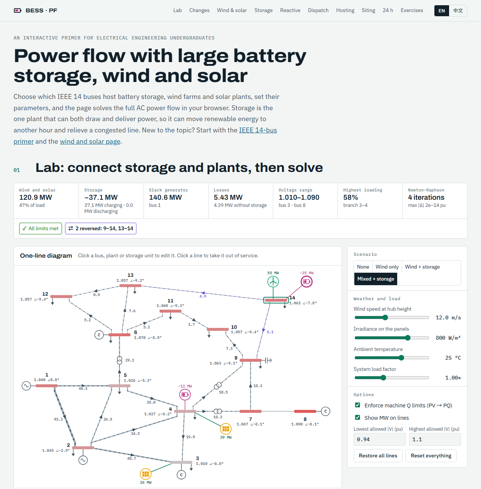

# Storage, Wind & Solar Power Flow

**[English](#english) · [中文](#中文)**

**Live demo / 在线访问：** https://hanjiang98.github.io/AI_toy/storage-powerflow/

---

## English

An interactive, bilingual (English / 中文) web page that introduces **power flow analysis with large battery energy storage, wind farms and solar plants** to electrical engineering undergraduates. It uses the IEEE 14-bus test system. English is the default language. It builds on two companion pages: [IEEE 14-Bus Power Flow](../powerflow-ieee14/) for the basics, and [Wind & Solar Power Flow](../renewable-powerflow/) for the renewable plant models.

> **About this project.** The code was generated with [Claude Code](https://claude.com/claude-code). It is intended **for teaching only**. It is not a validated engineering tool and should not be used for real system planning or operation. Feedback is very welcome: please [open an issue](https://github.com/hanjiang98/AI_toy/issues).

### What you can do

- **Choose where to connect.** Tick any buses to add storage units, wind farms and solar plants. A bus can host one of each.
- **Set storage parameters.** Power rating, energy capacity, state of charge (SOC), SOC limits, round-trip efficiency and converter rating.
- **Choose how storage is dispatched.**
  - Setpoint: a fixed charge or discharge power.
  - Firm local output: holds the bus's wind and solar plus storage at a target.
  - Level net load: charges in the valleys and discharges at the peaks of load minus renewables.
- **Choose the reactive control.** Constant power factor, voltage control or Q(V) droop, in all four quadrants. An idle unit can still support voltage.
- **Set wind and solar parameters** as on the companion page, and change wind speed, irradiance, temperature, load and line outages.
- **Read the results.** The AC power flow re-solves on every change. The page shows bus voltages, branch loading, reversed flows, losses, limit violations, and what the storage changes compared with the same case without it.

### What is on the page

| Section | Content |
|---|---|
| 01 Lab | Connection matrix, storage and plant editor, one-line diagram, charts and result tables |
| 02 What changes | How storage enters the power flow equations |
| 03 Wind and solar | Recap of the renewable models, with the selected plants' operating points |
| 04 Storage | Power, energy, SOC, efficiency, the one-hour power limits and the three dispatch rules |
| 05 Reactive control | Four-quadrant capability, and how each control mode maps to a bus type |
| 06 Dispatch | Sweeps the selected unit from full charge to full discharge and shows which powers meet every limit |
| 07 Hosting capacity | Scales wind and solar from 0 to 300%, with and without storage |
| 08 Siting | Adds a charging or discharging unit to each bus in turn and compares losses and limits |
| 09 24 hours | A quasi-static time series that carries each unit's SOC from hour to hour, with four strategies |
| 10 Exercises | Ten questions with answers. The numbers are computed by the solver at page load |

### Verification

Automated checks run during development, in headless Chrome:

- With no plants, the base case reproduces the published MATPOWER `case14` results: slack 232.39 MW and −16.55 MVAr, losses 13.393 MW, in 4 Newton–Raphson iterations.
- A charging storage unit gives exactly the same voltages as an equal extra load. A discharging unit at constant power factor matches an equivalent negative load. An idle unit in voltage control matches an equivalent PV generator.
- The SOC limits and the SOC update were checked against hand calculations. For example, 15% SOC with a 10% lower limit allows 3.75 MW for one hour, and holding that power ends the hour at exactly 10%.
- 800 random cases (716 solved, 68 without a solution, 16 islanded) showed no violation of bus power balance, system power balance, the converter S limit, the storage power and SOC limits, or the Q(V) law. In 96 random 24-hour runs (32 cases × 3 strategies), no SOC left its allowed band.
- The page was checked for script errors, undefined values and horizontal overflow in both languages at 1280 and 500 px, in light and dark themes.

**Human review of this page is still pending.** The storage cases have no external reference solution: they were cross-checked against equivalent models built from the same solver core, not against separate power flow software. The 68 random cases without a solution were not examined one by one.

### Modelling assumptions

- Each plant and storage unit is one equivalent machine connected directly to its bus, with no collector network or step-up transformer.
- Storage efficiency is constant, split evenly between charging and discharging (ηc = ηd = √ηrt), with no dependence on power, SOC or temperature, no auxiliary load and no degradation.
- A snapshot checks that the storage power can be held for one hour within the SOC limits.
- The dispatch rules are simple rules computed before the network solve. They are not an optimal power flow and they ignore network losses.
- Only steady-state, balanced operation is covered. There is no frequency response, stability, fault ride-through, harmonics or forecast uncertainty.
- The slack generator at bus 1 takes up every change in storage and renewable output.
- **Teaching values, not part of the IEEE test case:** storage and plant parameters, branch ratings (140% of base-case flow, rounded up to 5 MVA, minimum 20 MVA), the default voltage limits (0.94–1.10 pu), the daily profiles and the fixed schedule windows (charge 10:00–15:00, discharge 17:00–22:00).

### Run it locally

There is no build step. Everything is in the single file `index.html`. Open it in a modern browser. An internet connection is needed for the web fonts and for [MathJax 3.2.2](https://www.mathjax.org/) (loaded from jsDelivr). Offline, the solver and charts still work, but the equations appear as LaTeX source.

### Data and references

IEEE 14-bus test case from the [University of Washington Power Systems Test Case Archive](https://labs.ece.uw.edu/pstca/), with the same values as MATPOWER's `case14`.

- A. A. Akhil et al., *DOE/EPRI Electricity Storage Handbook in Collaboration with NRECA*, Sandia National Laboratories, SAND2015-1002, 2015.
- IEEE Std 2030.2.1-2019, guide for design, operation and maintenance of battery energy storage systems integrated with electric power systems.
- IEEE Std 2800-2022, interconnection and interoperability of inverter-based resources with transmission systems.
- T. Ackermann (ed.), *Wind Power in Power Systems*, 2nd ed., Wiley, 2012.
- G. M. Masters, *Renewable and Efficient Electric Power Systems*, 2nd ed., Wiley, 2013.
- J. J. Grainger, W. D. Stevenson, *Power System Analysis*, McGraw-Hill, 1994.

### Feedback

Found an error in the physics, a bug, or a translation that reads badly? Please [open an issue](https://github.com/hanjiang98/AI_toy/issues). Pull requests are welcome too.

### License

[MIT](../LICENSE)

---

## 中文

一个面向电气工程专业本科生的交互式双语（English / 中文）网页，以 IEEE 14 节点测试系统为例，介绍**接入大规模储能电站、风电场和光伏电站的电网潮流计算**。默认显示英文，可在页面右上角切换中文。本页建立在两个姊妹页面之上：基础知识见 [IEEE 14 节点潮流计算](../powerflow-ieee14/)，新能源电站模型见[风电光伏接入潮流计算](../renewable-powerflow/)。

> **关于本项目。** 本项目代码由 [Claude Code](https://claude.com/claude-code) 生成，**仅用于教学**。它不是经过工程验证的计算工具，请勿用于实际电网的规划或运行。欢迎反馈：请[提交 Issue](https://github.com/hanjiang98/AI_toy/issues)。

### 可以做什么

- **选择接入节点。** 勾选任意节点即可增加储能、风电场或光伏电站，每个节点每类最多一个。
- **设置储能参数。** 额定功率、额定容量、荷电状态（SOC）、SOC 上下限、往返效率和变流器容量。
- **选择储能的有功控制方式。**
  - 给定功率：固定的充电或放电功率。
  - 平抑本节点出力：把本节点风光出力与储能之和维持在目标值。
  - 削峰填谷：在净负荷（负荷减新能源）低谷时充电、高峰时放电。
- **选择无功控制方式。** 恒功率因数、恒电压或 Q(V) 下垂，可四象限运行。不充不放的储能仍能支撑电压。
- **设置风电和光伏参数**（与姊妹页面相同），并可改变风速、辐照度、温度、负荷和线路投切。
- **查看结果。** 每次修改都会重新求解交流潮流，页面显示节点电压、支路负载率、反向潮流、网损、越限情况，以及与去掉储能的同一算例相比，储能带来了哪些变化。

### 页面内容

| 章节 | 内容 |
|---|---|
| 01 实验台 | 接入节点矩阵、储能和电站参数编辑、单线图、图表和结果表 |
| 02 变化 | 储能如何进入潮流方程 |
| 03 风光回顾 | 新能源模型回顾，显示所选电站的运行点 |
| 04 储能 | 功率、能量、SOC、效率、一小时功率限值和三种控制策略 |
| 05 无功控制 | 四象限运行范围，以及各控制方式对应的节点类型 |
| 06 充放电 | 把所选储能从满功率充电扫描到满功率放电，显示满足全部限值的功率范围 |
| 07 承载能力 | 把风电和光伏从 0 放大到 300%，对比有无储能 |
| 08 选址 | 把一个充电或放电的储能依次接到各节点，比较网损和限值 |
| 09 24 小时 | 准静态时序仿真，逐小时传递每个储能的 SOC，提供四种策略 |
| 10 练习 | 10 道题及答案，答案中的数字都在页面加载时由求解器算出 |

### 验证

开发过程中在无头 Chrome 中运行的自动检查：

- 不接电站时，基础算例与 MATPOWER `case14` 的公开结果一致：平衡机 232.39 MW、−16.55 MVAr，网损 13.393 MW，牛顿法 4 次迭代。
- 充电储能与等量增加的负荷电压结果完全相同；恒功率因数放电与等效负负荷相同；不充不放、恒电压控制的储能与等效 PV 发电机相同。
- SOC 限值和 SOC 更新已与手算结果核对。例如 SOC 为 15%、下限为 10% 时，一小时内可放电 3.75 MW，按此功率运行一小时后 SOC 恰好为 10%。
- 800 个随机算例（716 个有解、68 个无解、16 个出现孤岛）中，节点功率平衡、系统功率平衡、变流器容量、储能功率与 SOC 限值、Q(V) 控制律均未出现违反。96 次随机 24 小时仿真（32 个算例 × 3 种策略）中，SOC 从未越出允许范围。
- 页面在 1280 px 和 500 px 宽度、中英文、浅色和深色主题下检查过，没有脚本错误、未定义数值和横向溢出。

**本页面的人工审查尚未完成。**储能算例没有外部参考解：它们是与同一求解器核心构建的等效模型对比，而不是与其他潮流软件对比。68 个无解的随机算例没有逐个检查。

### 模型假设

- 每座电站和每个储能都等值为一台直接接在节点上的机组，没有集电网络和升压变压器。
- 储能效率为常数，平均分配到充、放电两个方向（ηc = ηd = √ηrt），不随功率、SOC 和温度变化，不考虑辅助用电和电池衰减。
- 单张快照检查储能功率能否在 SOC 限值内维持一小时。
- 控制策略是在求解网络之前算出的简单规则，不是最优潮流，也不计网损。
- 只考虑三相平衡稳态运行，不考虑频率响应、稳定性、故障穿越、谐波和预测不确定性。
- 储能和新能源出力的任何变化都由节点 1 的平衡机承担。
- **以下是教学取值，不属于 IEEE 测试系统：** 储能和电站参数、支路容量（基础算例潮流的 140%，向上取整到 5 MVA，最小 20 MVA）、默认电压限值（0.94–1.10 pu）、典型日曲线和固定时间表的时段（10:00–15:00 充电、17:00–22:00 放电）。

### 本地运行

无需编译，全部代码都在 `index.html` 一个文件里，用现代浏览器打开即可。网页字体和 [MathJax 3.2.2](https://www.mathjax.org/)（从 jsDelivr 加载）需要联网。离线时求解器和图表仍可使用，但公式会显示为 LaTeX 源码。

### 数据与参考文献

IEEE 14 节点测试系统取自[华盛顿大学电力系统测试算例库](https://labs.ece.uw.edu/pstca/)，参数与 MATPOWER 的 `case14` 相同。参考文献见上方英文部分。

### 反馈

如果发现原理错误、程序 bug 或翻译不通顺的地方，请[提交 Issue](https://github.com/hanjiang98/AI_toy/issues)，也欢迎提交 Pull Request。

### 许可证

[MIT](../LICENSE)
